# X. Графы I: хранение, BFS и DFS

> [!NOTE]
> Конспект составлен по записи занятия 2026 года, [лекции «Графы-1» 2025 года](https://dawn-tail-db5.notion.site/VIII-1-2932e807d74f8086bdefd2e44d0ba8d9), [задачам к ней](https://dawn-tail-db5.notion.site/VIII-2932e807d74f80d683e5f6719f297b42) и [контесту занятия 2026 года](https://codeforces.com/group/ByhdE7NWBK/contest/724992).

Граф описывает объекты и связи между ними. Люди и знакомства, станции и перегоны, перекрёстки и дороги, аэропорты и рейсы — во всех этих примерах объекты становятся **вершинами**, а связи — **рёбрами**.

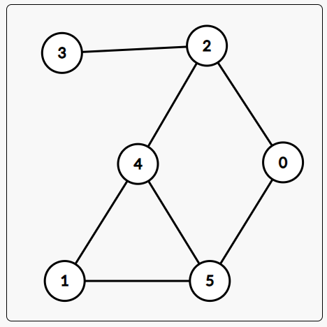

*Пример графа из прошлогоднего конспекта: шесть вершин и шесть рёбер.*

На занятии основной акцент был сделан на трёх вопросах:

1. как представить граф в памяти;
2. как обойти все достижимые вершины с помощью BFS или DFS;
3. как применить обход для поиска компонент связности.

## Содержание

- [Основные определения](#основные-определения)
- [Как хранить граф](#как-хранить-граф)
- [Переход между представлениями](#переход-между-представлениями)
- [Транзитивное замыкание](#транзитивное-замыкание)
- [BFS — обход в ширину](#bfs--обход-в-ширину)
- [DFS — обход в глубину](#dfs--обход-в-глубину)
- [Компоненты связности](#компоненты-связности)
- [Деревья и остов](#деревья-и-остов)
- [Задачи контеста 2026](#задачи-контеста-2026)
- [Чек-лист перед отправкой](#чек-лист-перед-отправкой)

Все программы в [`examples/`](examples/) самостоятельны и компилируются в C++17.

## Основные определения

Граф $G=(V,E)$ состоит из множества вершин $V$ и множества рёбер $E$. В программе удобно хранить вершины под индексами от `0` до `n - 1`, даже если во входных данных они пронумерованы от `1` до `n`.

### Ориентированный и неориентированный граф

В **ориентированном** графе ребро имеет направление: наличие $u\to v$ не означает наличия $v\to u$. Так можно описать авиарейсы или односторонние дороги.

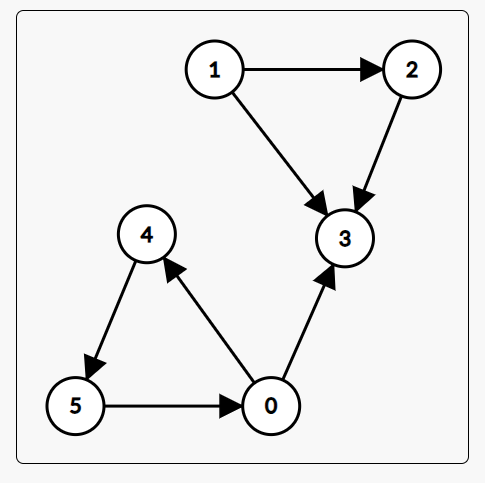

*Стрелка показывает, в какую сторону разрешено пройти по ребру.*

В **неориентированном** графе по ребру можно пройти в обе стороны. При чтении ребра `u v` его приходится добавлять в список соседей дважды:

```cpp
graph[u].push_back(v);
graph[v].push_back(u);
```

Для ориентированного графа нужна только первая строка.

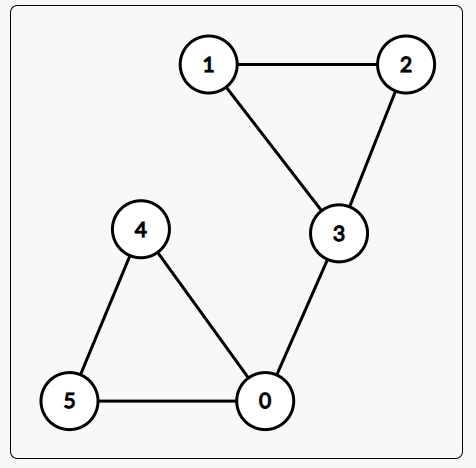

*У неориентированного ребра нет стрелки: по нему можно идти в обе стороны.*

### Пути и связность

**Путь** — последовательность вершин, в которой соседние вершины соединены рёбрами. Вершина `v` достижима из `s`, если существует путь из `s` в `v`.

Неориентированный граф **связен**, если из любой вершины можно добраться в любую другую. В несвязном графе вершины разбиваются на **компоненты связности**: внутри одной компоненты все вершины достижимы друг из друга, а между разными компонентами путей нет.

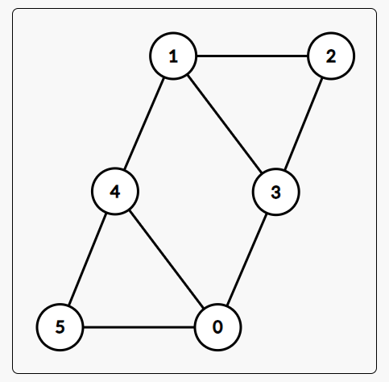

*Связный граф: все шесть вершин принадлежат одной компоненте.*

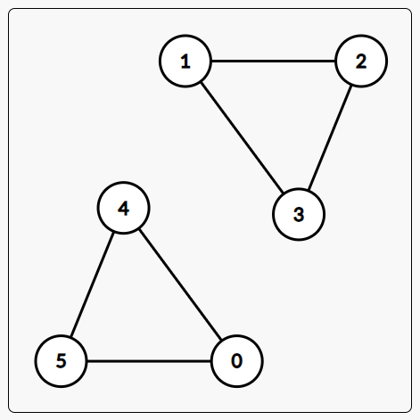

*Несвязный граф: здесь две компоненты связности.*

Для ориентированного графа различают:

- слабую связность — граф станет связным, если забыть направления рёбер;
- сильную связность — с учётом направлений из любой вершины можно добраться в любую другую.

Сильные компоненты будут подробно изучаться позже.

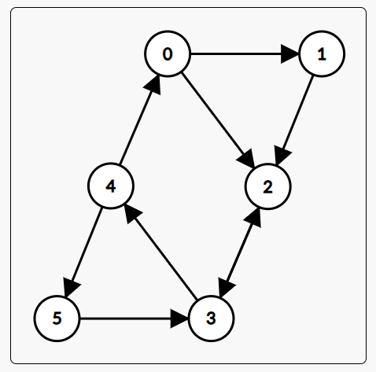

*В сильно связном ориентированном графе между любыми двумя вершинами существуют пути в обе стороны.*

### Петли, кратные рёбра и степени

- **петля** соединяет вершину саму с собой;
- **кратные рёбра** несколько раз соединяют одну и ту же пару вершин;
- **степень** вершины неориентированного графа — число инцидентных ей рёбер;
- в ориентированном графе отдельно считают полустепень входа и полустепень исхода.

В неориентированном графе сумма степеней равна $2m$: каждое ребро учитывается у двух концов. Петля тоже добавляет к степени два.

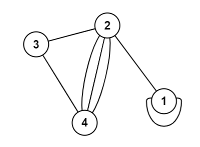

*У вершины `1` есть петля, а вершины `2` и `4` соединены кратными рёбрами.*

## Как хранить граф

Пусть в графе $n$ вершин и $m$ рёбер.

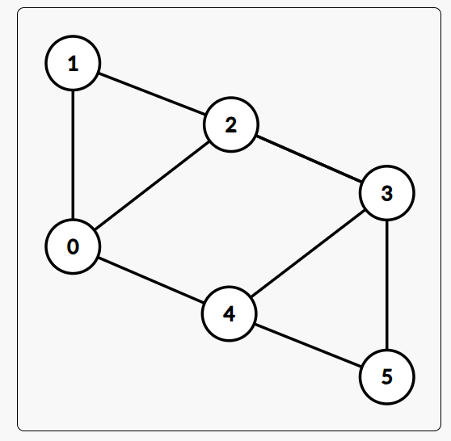

*Один и тот же граф ниже будет удобно мысленно представить списком рёбер, матрицей и списком смежности.*

| Представление | Память | Проверка ребра | Перебор соседей `v` |
| --- | ---: | ---: | ---: |
| список рёбер | $O(m)$ | $O(m)$ | $O(m)$ |
| матрица смежности | $O(n^2)$ | $O(1)$ | $O(n)$ |
| список смежности | $O(n+m)$ | $O(\deg(v))$ | $O(\deg(v))$ |

### Список рёбер

Храним пары концов:

```cpp
vector<pair<int, int>> edges;
edges.push_back({u, v});
```

Формат компактный и часто совпадает со входом задачи, но неудобен для обхода: чтобы найти соседей одной вершины, придётся смотреть почти все рёбра.

### Матрица смежности

`matrix[u][v]` равна `1`, если существует ребро $u\to v$.

```cpp
vector<vector<int>> matrix(n, vector<int>(n, 0));
matrix[u][v] = 1;
```

У неориентированного графа матрица симметрична, поэтому ставим также `matrix[v][u] = 1`.

Матрица полезна для маленьких или плотных графов и мгновенно отвечает на вопрос о наличии конкретного ребра. Но при $n=10^5$ она потребовала бы $10^{10}$ ячеек, поэтому для больших разреженных графов не подходит.

### Список смежности

Для каждой вершины храним только её реальных соседей:

```cpp
vector<vector<int>> graph(n);
graph[u].push_back(v);
```

Это основное представление для BFS и DFS. В неориентированном графе каждое ребро хранится дважды, поэтому суммарная длина всех списков равна $2m$, но асимптотика памяти всё равно $O(n+m)$.

> [!IMPORTANT]
> Если входные вершины нумеруются от единицы, сразу после чтения выполняйте `--u; --v;`. При выводе прибавляйте единицу обратно.

## Переход между представлениями

В записи занятия первые две задачи были разобраны именно как преобразования форматов.

### Матрица → списки смежности

Строка `u` матрицы уже описывает всех соседей `u`: достаточно выписать столбцы `v`, в которых стоит единица.

→ Решение [задачи 1](https://codeforces.com/group/ByhdE7NWBK/contest/724992/problem/1): [`examples/matrix_to_adjacency_list.cpp`](examples/matrix_to_adjacency_list.cpp).

Сложность неизбежно равна $O(n^2)$, потому что матрицу целиком нужно прочитать.

### Список рёбер → матрица

Для каждого неориентированного ребра отмечаем две клетки:

```cpp
matrix[u][v] = 1;
matrix[v][u] = 1;
```

→ Решение [задачи 2](https://codeforces.com/group/ByhdE7NWBK/contest/724992/problem/2): [`examples/edge_list_to_matrix.cpp`](examples/edge_list_to_matrix.cpp).

Заполнение занимает $O(m)$, вывод — $O(n^2)$.

## Транзитивное замыкание

Матрица транзитивного замыкания отвечает не на вопрос «есть ли прямое ребро $i\to j$», а на вопрос «существует ли какой-нибудь путь из $i$ в $j$».

На занятии матрицу многократно обновляли правилом:

$$
reachable[i][j] \mathrel{|}= reachable[i][k] \land reachable[k][j]
$$

до тех пор, пока она не переставала меняться. Более стандартная форма того же рассуждения — алгоритм Уоршелла. После обработки вершины `k` разрешены пути, чьи промежуточные вершины лежат среди `0..k`. Тогда одного тройного цикла достаточно:

```cpp
for (int k = 0; k < n; ++k) {
    for (int i = 0; i < n; ++i) {
        for (int j = 0; j < n; ++j) {
            reachable[i][j] |= reachable[i][k] && reachable[k][j];
        }
    }
}
```

→ Решение [задачи 3](https://codeforces.com/group/ByhdE7NWBK/contest/724992/problem/3): [`examples/transitive_closure.cpp`](examples/transitive_closure.cpp).

Сложность: $O(n^3)$ по времени и $O(n^2)$ памяти. При $n\le100$ тройной цикл выполняет не более $10^6$ итераций — это приемлемо.

## BFS — обход в ширину

**BFS** посещает вершины слоями: сначала стартовую, затем все вершины на расстоянии одного ребра, затем двух и так далее. Поэтому BFS умеет находить кратчайшие расстояния в невзвешенном графе.

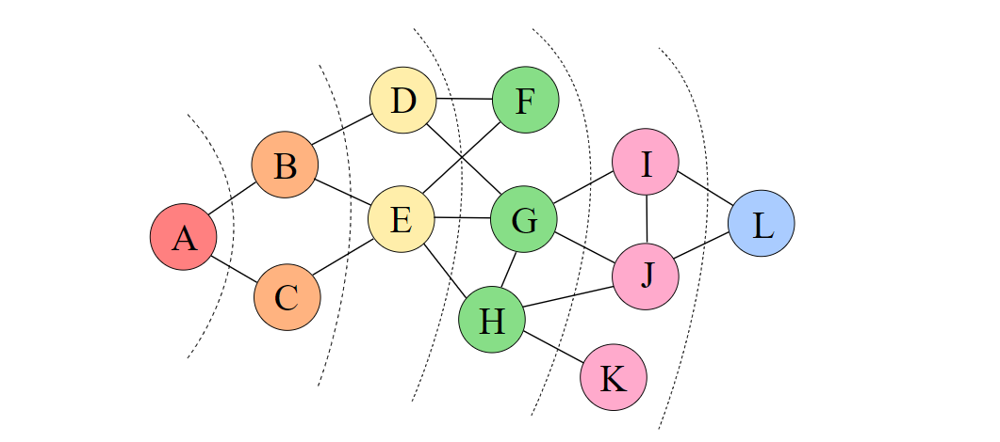

*Вершины одного цвета находятся на одинаковом расстоянии от стартовой вершины `A`.*

Нужны:

- очередь вершин, которые уже найдены, но ещё не обработаны;
- массив `used` или `distance`, чтобы не добавлять вершину повторно.

```cpp
queue<int> q;
vector<int> distance(n, -1);

distance[start] = 0;
q.push(start);

while (!q.empty()) {
    int vertex = q.front();
    q.pop();

    for (int to : graph[vertex]) {
        if (distance[to] == -1) {
            distance[to] = distance[vertex] + 1;
            q.push(to);
        }
    }
}
```

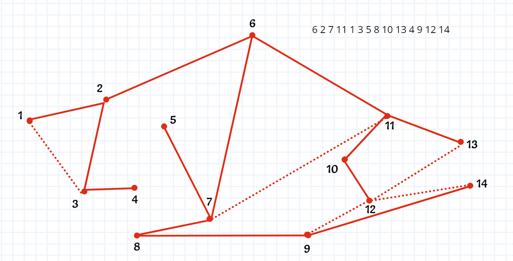

*Пример порядка BFS из прошлогоднего конспекта. Конкретный порядок вершин внутри одного слоя зависит от порядка соседей в списке смежности.*

> [!IMPORTANT]
> Помечайте вершину в момент добавления в очередь, а не при извлечении. Иначе один и тот же сосед может попасть в очередь много раз.

Каждая вершина добавляется в очередь не более одного раза, каждое ребро просматривается не более двух раз. Сложность по спискам смежности: $O(n+m)$.

→ Подсчёт вершин в компоненте из [задачи 4](https://codeforces.com/group/ByhdE7NWBK/contest/724992/problem/4): [`examples/reachable_count_bfs.cpp`](examples/reachable_count_bfs.cpp).

## DFS — обход в глубину

**DFS** пытается пройти по одному направлению как можно глубже. Когда из текущей вершины больше некуда идти, выполнение возвращается в предыдущую вершину.

```cpp
void dfs(int vertex) {
    used[vertex] = true;
    for (int to : graph[vertex]) {
        if (!used[to]) {
            dfs(to);
        }
    }
}
```

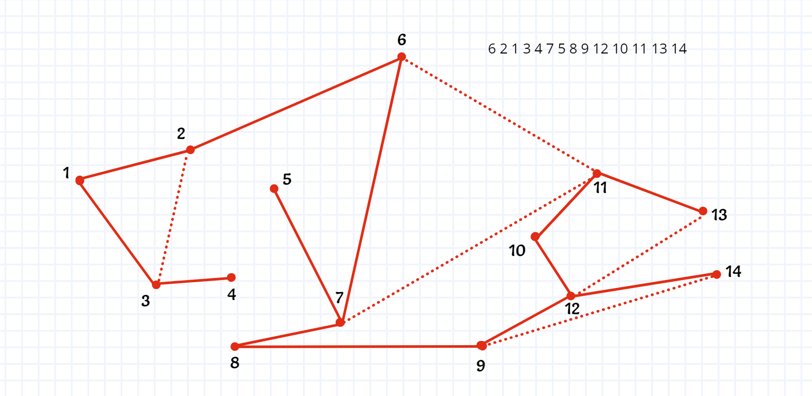

*DFS сначала уходит по выбранной ветви как можно глубже и только затем возвращается к альтернативам.*

Инвариант функции: после завершения `dfs(vertex)` посещены все ранее не посещённые вершины, достижимые из `vertex`.

Как и BFS, DFS работает за $O(n+m)$. Отличается порядок посещения и удобные применения: рекурсивным DFS естественно обрабатывать поддеревья, восстанавливать остов и выполнять действия при входе и выходе из вершины.

> [!WARNING]
> На длинной цепочке рекурсивная глубина может достигнуть $n$. При больших ограничениях используйте явный `stack<int>` или храните состояния обхода самостоятельно.

## Компоненты связности

Один запуск BFS или DFS находит ровно одну компоненту связности. Чтобы найти все компоненты, перебираем вершины и запускаем новый обход из каждой ещё не посещённой:

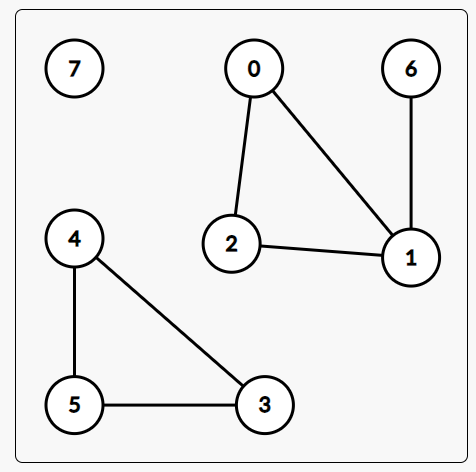

*В примере компоненты имеют вершины `{0, 1, 2, 6}`, `{3, 4, 5}` и `{7}`.*

```cpp
for (int vertex = 0; vertex < n; ++vertex) {
    if (used[vertex]) {
        continue;
    }
    components.push_back({});
    dfs(vertex);
}
```

Вершины разных запусков не пересекаются, а каждое ребро всё равно обрабатывается лишь константное число раз. Общая сложность остаётся $O(n+m)$, а не умножается на число компонент.

→ Решение [задачи 5](https://codeforces.com/group/ByhdE7NWBK/contest/724992/problem/5): [`examples/connected_components.cpp`](examples/connected_components.cpp).

→ Как соединить компоненты минимальным числом рёбер: [`examples/connect_graph.cpp`](examples/connect_graph.cpp).

Если компонент $k$, требуется не меньше $k-1$ новых рёбер. Достаточно выбрать по одному представителю и соединить их цепочкой.

## Деревья и остов

**Дерево** — связный неориентированный граф без циклов. Для простого неориентированного графа эквивалентны любые два из трёх свойств:

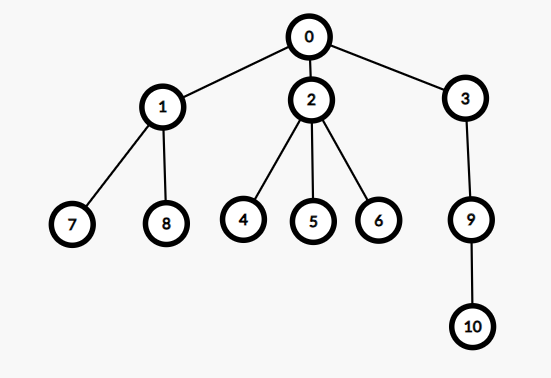

*Дерево с корнем `0`: у каждой другой вершины есть ровно один родитель.*

1. граф связен;
2. циклов нет;
3. рёбер ровно $n-1$.

Поэтому для проверки дерева достаточно убедиться, что `m == n - 1`, а обход посетил все вершины.

→ Проверка дерева: [`examples/is_tree.cpp`](examples/is_tree.cpp).

**Остовное дерево** связного графа содержит все вершины и только рёбра, по которым обход впервые пришёл в новые вершины. Таких рёбер будет ровно $n-1$.

→ Построение остова: [`examples/spanning_tree.cpp`](examples/spanning_tree.cpp).

## Задачи контеста 2026

| Задача | Основная идея |
| --- | --- |
| [1. От матрицы смежности к спискам смежности](https://codeforces.com/group/ByhdE7NWBK/contest/724992/problem/1) | выписать единицы в каждой строке матрицы |
| [2. От списка рёбер к матрице смежности](https://codeforces.com/group/ByhdE7NWBK/contest/724992/problem/2) | отметить обе клетки каждого неориентированного ребра |
| [3. Транзитивное замыкание](https://codeforces.com/group/ByhdE7NWBK/contest/724992/problem/3) | достижимость всех пар, алгоритм Уоршелла |
| [4. Обход графа](https://codeforces.com/group/ByhdE7NWBK/contest/724992/problem/4) | BFS или DFS из заданной вершины |
| [5. Компоненты связности](https://codeforces.com/group/ByhdE7NWBK/contest/724992/problem/5) | новый обход из каждой непосещённой вершины |
| [A. Полустепени вершин по спискам рёбер](https://codeforces.com/group/ByhdE7NWBK/contest/724992/problem/A) | отдельно считать входящие и исходящие рёбра |
| [B. Степени вершин по спискам рёбер](https://codeforces.com/group/ByhdE7NWBK/contest/724992/problem/B) | увеличить степень обоих концов ребра |
| [C. Истоки и стоки](https://codeforces.com/group/ByhdE7NWBK/contest/724992/problem/C) | исток имеет нулевую полустепень входа, сток — исхода |
| [D. Получи дерево](https://codeforces.com/group/ByhdE7NWBK/contest/724992/problem/D) | записать рёбра первого посещения при обходе |
| [E. Дерево ли?](https://codeforces.com/group/ByhdE7NWBK/contest/724992/problem/E) | `m == n - 1` и связность |
| [ZA. Свяжите графа](https://codeforces.com/group/ByhdE7NWBK/contest/724992/problem/ZA) | соединить представителей соседних компонент |
| [ZB. Распространение новостей](https://codeforces.com/group/ByhdE7NWBK/contest/724992/problem/ZB) | размер компоненты для каждой вершины |
| [ZC. Кефа и парк](https://codeforces.com/group/ByhdE7NWBK/contest/724992/problem/ZC) | DFS по дереву и состояние пути до вершины |

Дополнительные полные примеры:

- [`examples/news_distribution.cpp`](examples/news_distribution.cpp) — размеры компонент после объединения групп;
- [`examples/kefa_and_park.cpp`](examples/kefa_and_park.cpp) — обход дерева с числом подряд идущих вершин с кошками.

## Чек-лист перед отправкой

- Учтена ли ориентация графа? Нужно добавлять обратное ребро или нет?
- Переведены ли номера из входной нумерации в индексы C++?
- Соответствует ли представление ограничениям по памяти?
- Стартовая вершина помечена до начала BFS/DFS?
- В BFS вершина помечается при добавлении в очередь?
- Обработан ли несвязный граф внешним циклом по всем вершинам?
- Не перепутаны ли степень входа и степень исхода?
- Учтены ли изолированные вершины?
- Не переполнится ли стек вызовов рекурсивного DFS?
- Сложность обхода записана как $O(n+m)$, а не только $O(n)$?
