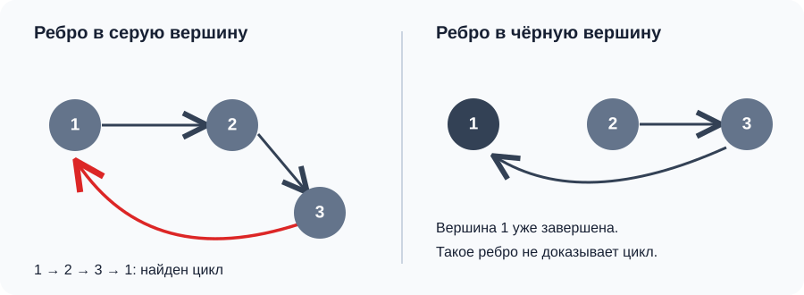
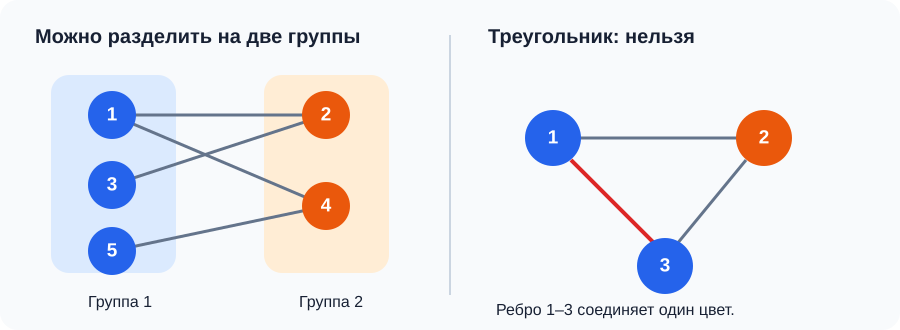
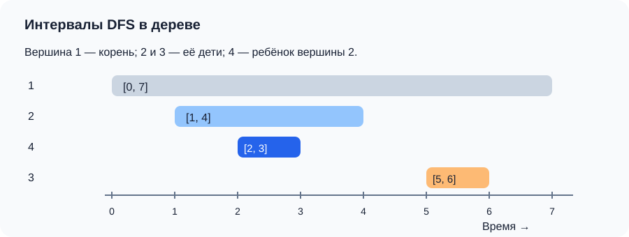
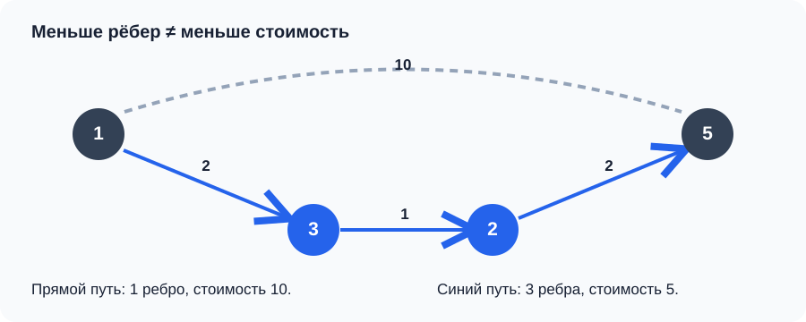

# XI. Графы II: циклы, двудольность и кратчайшие пути

> [!NOTE]
> Основной источник — запись занятия 20.10.2026 `Видеовстреча 2026-10-20_194209.webm`. Дополнительные материалы: [прошлогодняя лекция «Графы-2»](https://app.notion.com/p/2a12e807d74f8061bfa3e685a5c60b6c?pvs=204) и [контест занятия 2026 года](https://codeforces.com/group/ByhdE7NWBK/contest/725852). Там, где набор тем или порядок разбора различаются, ниже отражено занятие 2026 года.

В [предыдущем занятии](../10-graphs-1/) мы научились хранить граф и обходить его с помощью DFS и BFS. Теперь используем обход как основу для конкретных задач: найти цикл, проверить возможность разделить вершины на две группы, быстро отвечать на вопросы о предках и находить кратчайшие пути. Последняя задача приведёт от обычного BFS к алгоритму Дейкстры для графов с весами.

## Содержание

- [Цикл в ориентированном графе](#цикл-в-ориентированном-графе)
- [Восстановление цикла](#восстановление-цикла)
- [Двудольный граф](#двудольный-граф)
- [Предки в дереве и время DFS](#предки-в-дереве-и-время-dfs)
- [Кратчайший путь в невзвешенном графе](#кратчайший-путь-в-невзвешенном-графе)
- [Взвешенный граф и алгоритм Дейкстры](#взвешенный-граф-и-алгоритм-дейкстры)
- [Практика занятия](#практика-занятия)
- [Главное к запоминанию](#главное-к-запоминанию)

Определения, применимые и к другим занятиям курса, собраны в [общем глоссарии](../glossary.md); роль терминов в этой лекции — в [локальном глоссарии](glossary.md). Самостоятельные программы находятся в [`examples/`](examples/README.md); ссылки на них стоят рядом с соответствующими объяснениями.

## Цикл в ориентированном графе

Ориентированный цикл — путь по направлению рёбер, который возвращается в исходную вершину. Например, рёбра `1 → 2`, `2 → 3`, `3 → 1` образуют цикл. Для его поиска лектор начинает с обычного DFS: при входе в вершину отмечает её, а затем рекурсивно проходит ещё не посещённых соседей. Если граф не обязательно достижим из одной вершины, DFS запускается из каждой оставшейся непосещённой вершины.

Одного признака «вершину уже посещали» недостаточно. DFS мог полностью обработать одну ветку, вернуться назад и из другой ветки увидеть ребро в вершину первой. Такого ребра само по себе не хватает, чтобы получить цикл. Нужно отличать вершину, **которая сейчас находится на пути рекурсии**, от вершины, обработка которой уже закончена.

Для этого храним три состояния:

| `color[v]` | Смысл |
| --- | --- |
| `0` (белая) | Вершину ещё не посещали. |
| `1` (серая) | В вершину вошли, но ещё не вернулись из её DFS-вызова. |
| `2` (чёрная) | Все доступные из неё продолжения уже обработаны. |

При входе в `v` ставим `color[v] = 1`, при выходе — `2`. Если из `v` есть ребро в серую вершину `u`, то `u` уже лежит на текущем пути DFS. Отрезок этого пути от `u` до `v` вместе с ребром `v → u` образует цикл. Ребро в чёрную вершину такого вывода не даёт. [Запускаемый пример проверки цикла](examples/directed_cycle.cpp) печатает `YES` или `NO`.



Например, при DFS по рёбрам `1 → 2 → 3 → 1` к моменту рассмотрения последнего ребра вершины `1`, `2`, `3` ещё серые: DFS не успел вернуться из них. Ребро `3 → 1` замыкает текущий путь. Если же DFS уже завершил вершину `1` и пометил её чёрной, другое ребро в `1` не создаёт такого замыкания.

Каждая вершина и каждое ребро рассматриваются не более постоянного числа раз, поэтому сложность — $O(n+m)$ по времени и $O(n+m)$ по памяти вместе со списком смежности.

## Восстановление цикла

Проверить наличие цикла иногда мало: задача может требовать выписать его вершины. При переходе DFS в новую вершину `to` запоминаем `parent[to] = v`. Пусть ребро `v → u` привело к серой вершине `u`. Тогда `u` — начало искомого отрезка пути, а `v` — его конец.

Идём от `v` по массиву `parent` до `u`, добавляя вершины в ответ, затем добавляем `u`. Полученная последовательность идёт против направления рёбер DFS, поэтому разворачиваем её. Например, для `1 → 2 → 3 → 1` проход от `3` по предкам даст `3, 2, 1`, а после разворота — `1, 2, 3`. Замыкающее ребро `3 → 1` уже известно; повторять первую вершину в конце нужно только тогда, когда этого требует формат ответа.

Остановить поиск после первого найденного цикла удобно и для правильного восстановления: сохранённая пара `u`, `v` не будет случайно заменена следующим обратным ребром. Как и сама проверка, восстановление укладывается в $O(n+m)$ времени с учётом обхода графа.

## Двудольный граф

Во второй задаче занятия студенты связаны ребром, если могут списывать друг у друга. Требуется разделить их на две группы так, чтобы внутри каждой не было ребра. Это и есть проверка **двудольности** неориентированного графа, или раскраска его вершин в два цвета.

Начнём с произвольной вершины и назначим ей цвет `1`. Каждому соседу назначаем `2`, каждому его ещё не окрашенному соседу — снова `1`. Формула `3 - color[v]` меняет `1` на `2` и наоборот. Если встретилось ребро, оба конца которого имеют одинаковый цвет, требуемое разделение невозможно. Если противоречий нет, вершины первого цвета образуют одну группу, второго — другую. [Пример раскраски через DFS](examples/bipartite.cpp) выводит одну из групп.



Обход нужно начинать в каждой ещё не окрашенной компоненте: граф может быть несвязным. Начальный цвет каждой компоненты можно выбрать произвольно. Пример полезной проверки — треугольник: при чередовании цветов его третье ребро неизбежно соединит одинаково окрашенные вершины. На цепочке противоречия не возникнет. Время работы — $O(n+m)$.

Во второй половине занятия лектор повторяет эту же задачу через **BFS**: вместо рекурсивных вызовов он кладёт найденных соседей в очередь и назначает им противоположный цвет при добавлении. Проверка ребра с одинаковыми цветами и необходимость пройти все компоненты остаются теми же. Это показывает, что для раскраски подходят оба обхода; выбор зависит от того, в каком порядке удобнее обрабатывать вершины.

## Предки в дереве и время DFS

В третьей задаче дано корневое дерево и много запросов вида «является ли `a` предком `b`?». В дереве между корнем и каждой вершиной есть единственный путь, поэтому ответ можно получить, поднимаясь от `b` по родителям. Но повторять такой подъём для каждого запроса долго; лектор предлагает сначала один раз обойти дерево DFS.

Заводим общий счётчик `timer`. При входе в вершину `v` записываем `tin[v] = timer++`, при окончательном выходе — `tout[v] = timer++`. Пока DFS обрабатывает поддерево `a`, счётчик успевает отметить вход и выход из всех его потомков. Поэтому интервалы вложены:

```text
tin[a] < tin[b] < tout[b] < tout[a]   если a — строгий предок b
```

У вершин из разных ветвей такие интервалы не вложены. Значит, после предварительного обхода за $O(n)$ каждый запрос проверяется за $O(1)$. В задаче занятия нужен **строгий** предок, поэтому сравниваем `tin[a] < tin[b] && tout[b] < tout[a]`. Если по условию вершина считается предком самой себя, используем нестрогие неравенства. [Запускаемый пример](examples/ancestor_queries.cpp) читает для каждой вершины номер родителя (`0` обозначает корень) и отвечает на запросы `1` или `0`.



Например, если у корня `1` есть дети `2` и `3`, а у `2` — ребёнок `4`, то DFS может записать `tin[2] = 1`, `tin[4] = 2`, `tout[4] = 3`, `tout[2] = 4`. Интервал вершины `4` целиком лежит внутри интервала `2`, поэтому `2` — её предок. Ветвь вершины `3` будет обработана после выхода из `2`, и её интервал уже не вложится в интервал `2`.

Если исходные рёбра дерева неориентированные, при DFS нужно пропускать ребро к родителю. В примере вместо этого строится направленный список детей, как и при разборе задачи в лекции.

## Кратчайший путь в невзвешенном графе

После задач на DFS лектор возвращается к BFS. Очередь обрабатывает вершины слоями: сначала стартовую, затем находящиеся в одном ребре от неё, потом в двух и так далее. Поэтому **первое обнаружение** вершины даёт кратчайшее число рёбер до неё. Обычный DFS такого порядка не гарантирует.


Храним `dist[v] = -1` для ещё не найденных вершин, а для старта ставим `0`. Когда из очереди извлечена вершина `v` и найден её сосед `u` с `dist[u] == -1`, присваиваем `dist[u] = dist[v] + 1` и кладём `u` в очередь. Так `dist` одновременно заменяет массив `used`.

Чтобы получить не только длину, но и сам путь, при первом обнаружении `u` запоминаем `parent[u] = v`. От финиша идём по родителям до старта, затем разворачиваем список. Если `dist[finish] == -1`, пути нет; в разборе задачи лектор отдельно добавляет этот случай после проверки решения. [Программа для поиска пути](examples/bfs_path.cpp) читает граф в виде матрицы смежности, преобразует её в список и выводит расстояние и вершины пути либо `-1`.

Сам BFS работает за $O(n+m)$ времени и памяти при списках смежности. Если вход задан матрицей $n\times n$, её чтение занимает $O(n^2)$ независимо от скорости последующего обхода.

## Взвешенный граф и алгоритм Дейкстры

Во взвешенном графе у ребра есть стоимость: длина дороги, время поездки или цена билета. Теперь кратчайший путь — это путь с минимальной **суммой весов**, а не обязательно с наименьшим количеством рёбер. Путь из одного тяжёлого ребра может оказаться дороже пути из нескольких лёгких, поэтому обычная очередь BFS больше не гарантирует правильный порядок обработки.

Пусть прямое ребро `1 → 5` весит `10`, а рёбра `1 → 3`, `3 → 2`, `2 → 5` имеют веса `2`, `1`, `2`. По числу рёбер первый путь короче, но его стоимость `10`, тогда как стоимость пути через три ребра равна `5`. Именно поэтому в этой части лекции расстояние перестаёт быть номером слоя BFS.



Идея Дейкстры сохраняет важное свойство BFS: следующей окончательно обрабатывается вершина с минимальным известным расстоянием. Для этого у каждой вершины есть `dist[v]` — лучшая найденная стоимость пути от старта; изначально она бесконечна, кроме `dist[start] = 0`. При обработке ребра `v → u` с весом `w` пробуем **улучшить** расстояние:

```text
если dist[v] + w < dist[u]:
    dist[u] = dist[v] + w
    parent[u] = v
```

Такое обновление называют релаксацией. В отличие от BFS вершина может получить несколько последовательных улучшений, поэтому помечать её окончательно посещённой при первом обнаружении нельзя. Когда же она выбрана как вершина с наименьшим текущим расстоянием, при **неотрицательных весах** более дешёвый путь к ней через ещё не обработанные вершины уже не появится. Отрицательные веса нарушают это обоснование; для них данный алгоритм не подходит.

### Вариант с `set`: разреженный граф

В первой реализации занятия множество `set<pair<long long, int>>` хранит пары `{dist[v], v}` для найденных, но ещё не обработанных вершин. Наименьшая пара находится через `begin()`. Если путь к `u` улучшился, удаляем старую пару `{dist[u], u}`, обновляем `dist[u]` и вставляем новую. Так в множестве остаётся не более одной записи для каждой вершины. В списке смежности удобно хранить пары `{сосед, вес}`; важно не перепутать их порядок с парами в `set`.

[Запускаемый пример с `set`](examples/dijkstra_set.cpp) ищет путь из вершины `1` в вершину `n` в неориентированном графе с неотрицательными весами. При успешной релаксации он обновляет `parent[u]`, а после обхода восстанавливает путь от финиша к старту так же, как в BFS. Для недостижимого финиша выводится `-1`. В примере для самостоятельной проверки сначала выводится стоимость, затем вершины пути; при отправке в конкретную задачу формат нужно сверить с её условием.

Извлечение и обновление в `set` занимают $O(\log n)$. За весь алгоритм вершины извлекаются не более $n$ раз, а рёбра просматриваются $O(m)$ раз. Поэтому полная оценка — $O((n+m)\log n)$ по времени и $O(n+m)$ по памяти. Для связного графа её часто сокращают до $O(m\log n)$.

### Вариант без `set`: плотный граф

Если рёбер почти $n^2$, логарифм в оценке предыдущего варианта становится заметен. Во второй реализации занятия лектор убирает `set`. На каждом шаге он перебирает все ещё не обработанные вершины и выбирает ту, у которой `dist` минимально. Массив `used` здесь отмечает именно вершины, расстояние до которых уже окончательно определено. Если достижимых необработанных вершин не осталось, цикл завершается; иначе выбранную вершину отмечают и релаксируют её рёбра.

[Запускаемый плотный вариант](examples/dijkstra_dense.cpp) использует тот же формат взвешенного графа и выводит минимальную стоимость из `1` в `n` либо `-1`. Поиск минимума стоит $O(n)$ и повторяется не более $n$ раз, просмотр всех рёбер — $O(m)$ суммарно. Получаем $O(n^2+m)$, то есть $O(n^2)$ для простого графа. Для разреженного графа обычно выгоднее вариант с `set`.

## Практика занятия

В [контесте №11 «Графы-2»](https://codeforces.com/group/ByhdE7NWBK/contest/725852) первые пять задач следуют ходу лекции:

| Задача | Основной приём |
| --- | --- |
| «Есть ли цикл?» | Трёхцветный DFS в ориентированном графе. |
| «Долой списывание!» | Проверка двудольности через DFS или BFS. |
| «Предок» | Время входа и выхода из вершины дерева. |
| «Путь в графе» | BFS, расстояния и восстановление пути. |
| «Алгоритм Дейкстры?» | Кратчайший путь во взвешенном графе. |

В контесте есть и дополнительные задачи. Перед отправкой решения проверяйте направление рёбер, нумерацию вершин, случай недостижимого финиша, возможность пути нулевой длины и точный формат вывода: два последних случая лектор исправлял при проверке задачи на BFS.

## Главное к запоминанию

- Для цикла в ориентированном графе важно ребро в вершину, которая **ещё находится на текущем пути DFS**. Просто посещённая ранее вершина не доказывает наличие цикла.
- В двудольном графе каждое ребро соединяет разные цвета. Проверку нужно выполнить для всех компонент.
- В корневом дереве интервал DFS потомка целиком лежит внутри интервала предка. После одного обхода запрос о предке требует только двух сравнений.
- BFS даёт кратчайшее число рёбер в невзвешенном графе. Массив предков позволяет восстановить сам путь.
- Дейкстра минимизирует сумму **неотрицательных** весов. Для разреженного графа удобен `set` с оценкой $O((n+m)\log n)$, для плотного — перебор вершин за $O(n^2)$.
