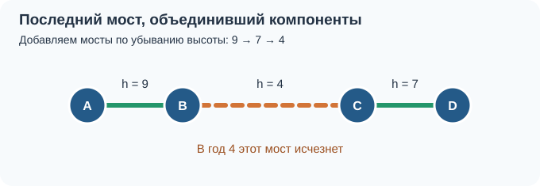
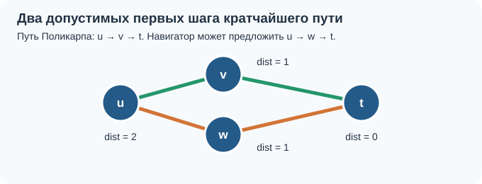

# XII. Разбор третьего тестирования

> [!NOTE]
> Источники: [контест «12. Testing-3» в группе Коалиции](https://codeforces.com/group/ByhdE7NWBK/contest/726770), проведённый 24.10.2026, и [прошлогодний разбор третьего тестирования в Notion](https://app.notion.com/p/2a12e807d74f800abdc8e25fb894b9e6). В Notion совпадают задачи `C`, `D`, `F` и `ZA`; для остальных задач ниже приведён самостоятельный разбор по условиям контеста 2026 года. Записи устного обсуждения этого тестирования в доступных материалах нет.

В этом тестировании первые две задачи требуют аккуратно разобрать достижимость. Затем идут компоненты связности в обычном графе, графе точек и сетке. Завершают основную часть восстановление пути после BFS и три более сложных применения обхода и связности. Для каждой задачи есть [запускаемая реализация на C++17](examples/README.md).

## A. Защитить овец

[Условие](https://codeforces.com/group/ByhdE7NWBK/contest/726770/problem/A). Волк перемещается по соседним по стороне клеткам, а собак можно ставить в любые свободные клетки. Если волк уже стоит рядом с овцой, защитить её невозможно: поставить собаку на одну из этих двух клеток нельзя. Во всех остальных случаях посадим собак **во все пустые клетки**. Волки тогда вообще не смогут выйти из своих клеток и добраться до овец.

Достаточность следует из того, что после заполнения пустот шаг волка возможен только в соседнюю занятую овцой клетку; именно такие пары мы проверили заранее. Диагональное соседство не имеет значения. Время $O(RC)$, память $O(RC)$ для поля. [Код](examples/a_protect_sheep.cpp).

## B. Метро

[Условие](https://codeforces.com/group/ByhdE7NWBK/contest/726770/problem/B). Первый путь идёт от станции `1` к большим номерам, второй — в обратную сторону. Если станция `1` закрыта на первом пути, Боб не сможет начать поездку. Если станция `s` открыта на первом пути, он доедет сразу.

Иначе Боб обязан проехать станцию `s`, пересесть на обратный путь на некоторой станции `i > s`, где открыты **оба** пути, и выйти на `s`, которая должна быть открыта на обратном пути. Пересадка до `s` не поможет: после неё номера только уменьшаются. Итак, ответ `YES` тогда и только тогда, когда `a[1] = 1` и либо `a[s] = 1`, либо `b[s] = 1` и существует `i > s` с `a[i] = b[i] = 1`. Время $O(n)$, память $O(n)$. [Код](examples/b_metro.cpp).

## C. Свяжите графа

[Условие](https://codeforces.com/group/ByhdE7NWBK/contest/726770/problem/C). Обойдём граф и возьмём по одной вершине из каждой компоненты связности. Если компонент $k$, нужно не меньше $k-1$ новых рёбер: одно ребро может уменьшить их число максимум на единицу. Этой границы достигаем, соединяя представителя первой компоненты с представителем каждой следующей. В прошлогоднем разборе показаны оба способа найти компоненты — BFS и DFS; на ответ выбор обхода не влияет. Ниже использован итеративный DFS. Время $O(N+M)$, память $O(N+M)$. [Код](examples/c_connect_graph.cpp).

## D. Катание на коньках

[Условие](https://codeforces.com/group/ByhdE7NWBK/contest/726770/problem/D). Два сугроба достижимы друг из друга, если имеют одинаковую координату `x` или `y`: можно оттолкнуться вдоль соответствующей прямой и, возможно, остановиться на промежуточных сугробах. Построим воображаемый граф с ребром между каждой такой парой. Дополнительный сугроб в точке `(x_i, y_j)` объединяет компоненты сугробов `i` и `j`: он лежит на вертикали первого и горизонтали второго.

Если компонент $k$, меньше $k-1$ новых сугробов недостаточно, потому что один новый сугроб может соединить максимум две ранее раздельные компоненты. Это ограничение отдельно объяснено в прошлогоднем разборе: если бы один сугроб объединил три компоненты, две из них уже имели бы общую горизонталь или вертикаль. Конструкция выше последовательно объединяет их за $k-1$ шагов. Существующий сугроб не может занимать выбранную точку `(x_i, y_j)`, иначе компоненты уже были бы соединены. При $n\le100$ можно сравнить все пары: время $O(n^2)$, память $O(n)$. [Код](examples/d_ice_skating.cpp).

## E. Озёра

[Условие](https://codeforces.com/group/ByhdE7NWBK/contest/726770/problem/E). Клетки положительной глубины, соседние по стороне, образуют компоненту — озеро. Запускаем обход из каждой ещё не посещённой водной клетки и суммируем глубины. Ответ — наибольшая сумма среди компонент; если воды нет, он равен нулю. Нулевые клетки разделяют озёра, даже если вода соприкасается по диагонали.

Обход выполнен итеративно: на поле до $10^6$ клеток рекурсивный DFS может переполнить стек вызовов. Каждая клетка посещается не более одного раза, поэтому время $O(nm)$, память $O(nm)$; сумма по тестам также ограничена $10^6$. Сумму храним в `long long`. [Код](examples/e_lakes.cpp).

## F. Кратчайший путь в невзвешенном графе

[Условие](https://codeforces.com/group/ByhdE7NWBK/contest/726770/problem/F). Рёбра **ориентированы**. Запускаем BFS из `s`, при первом посещении вершины `v` запоминаем `parent[v] = u`. BFS посещает вершины по неубыванию расстояния: сначала старт на расстоянии ноль, затем все достижимые из него вершины на расстоянии один, затем их ещё не посещённые соседи на расстоянии два и так далее. Именно это послойное рассуждение выделено в прошлогоднем разборе. Поэтому первая запись родителя задаёт кратчайший путь. Если `t` не посещена, выводим `-1`; иначе идём по `parent` от `t` к `s` и разворачиваем список. В первой строке требуется число **рёбер** пути, то есть на единицу меньше числа вершин в списке. Время и память $O(n+m)$. [Код](examples/f_shortest_path.cpp).

## ZA. Венеция

[Условие](https://codeforces.com/group/ByhdE7NWBK/contest/726770/problem/ZA). Через $y$ лет работают лишь мосты с исходной высотой строго больше $y$. Найдём самое высокое значение $h$, при котором мосты высоты не меньше $h$ ещё соединяют все острова. Если мысленно отступить от этого момента к моменту $y=h$, мосты высоты $h$ уже исчезли, а оставшихся мостов недостаточно для связности. Значит, ответ равен $h$.

Отсортируем мосты по убыванию высоты и добавляем их в систему непересекающихся множеств (DSU). Сначала каждый остров образует отдельное множество; добавление моста объединяет множества его концов, если они были разными. Высота моста, после добавления которого острова впервые становятся одной компонентой, и есть искомый ответ. Это та же минимальная высота ребра максимального остовного дерева. Время $O(B\log B)$, память $O(A+B)$. Несколько мостов между парой островов допустимы. [Код](examples/za_venice.cpp).

В прошлогоднем разборе используется другой способ: бинарный поиск по высоте $h$. Проверка оставляет мосты с исходной высотой не меньше $h$ и обходит полученный граф. Если он связен, можно попробовать увеличить $h$; иначе уменьшить. Наибольшее подходящее $h$ совпадает с ответом, который даёт DSU. Такая проверка занимает $O(A+B)$, весь поиск — $O((A+B)\log H)$, где $H$ — максимальная высота моста. [Код варианта с бинарным поиском](examples/za_venice_binary_search.cpp).

## ZB. Рождественские деревья

[Условие](https://codeforces.com/group/ByhdE7NWBK/contest/726770/problem/ZB). Требуется выбрать $m$ свободных целых точек с наименьшей суммой расстояний до ближайшего дерева. Представим все деревья как стартовые вершины BFS на бесконечной числовой прямой, а переходы — шаги на `-1` и `+1`. При первом посещении точки BFS уже нашёл её расстояние до ближайшего дерева. Занятые позиции храним в хеш-множестве.

В очередь сначала кладём все деревья с расстоянием ноль. Каждый раз берём очередную точку и предлагаем её ещё не посещённых соседей. Первые $m$ обнаруженных свободных точек имеют $m$ наименьших возможных расстояний; любой другой выбор не уменьшит сумму. Завершаем обход сразу после их нахождения. Время $O(n+m)$ в среднем, память $O(n+m)$; сумма расстояний требует `long long`. [Код](examples/zb_christmas_trees.cpp).

## ZC. Система навигации

[Условие](https://codeforces.com/group/ByhdE7NWBK/contest/726770/problem/ZC). Для каждого перекрёстка `v` найдём `dist[v]` — длину кратчайшего пути **от него до `t`**. Для этого запускаем BFS из `t` по развёрнутым рёбрам. Ребро `u → v` может быть первым шагом кратчайшего маршрута ровно тогда, когда `dist[u] = dist[v] + 1`.

Проверяем каждое ребро заданного пути Поликарпа:

- Если равенство не выполнено, навигатор при любом выборе предложит другое ребро. Увеличиваем и минимум, и максимум перестроений.
- Если равенство выполнено, перестроения можно избежать. Но если из `u` есть **два или больше** ребра к вершинам с расстоянием `dist[u]-1`, навигатор может выбрать другое кратчайшее продолжение. Тогда увеличиваем только максимум.

Число кратчайших продолжений считаем отдельно для каждой вершины при обходе исходных рёбер. У маршрута, все шаги которого уменьшают расстояние на единицу, каждый суффикс тоже кратчайший, поэтому выборы, необходимые для минимума, согласованы. При несовпадении навигатор перестраивается и снова свободен выбрать кратчайшее продолжение, что позволяет достичь максимума. Время и память $O(n+m+k)$. [Код](examples/zc_navigation.cpp).

## Что объединяет задачи

В `C`, `D` и `E` сначала нужно решить, что считать вершиной и когда две вершины принадлежат одной компоненте. В `F` и `ZC` BFS даёт расстояния, но направление его запуска разное: от старта для восстановления пути и от цели по обратным рёбрам для оценки каждого шага готового маршрута. В `ZA` связность удобно рассматривать в обратном времени — добавлять мосты по убыванию высоты.
