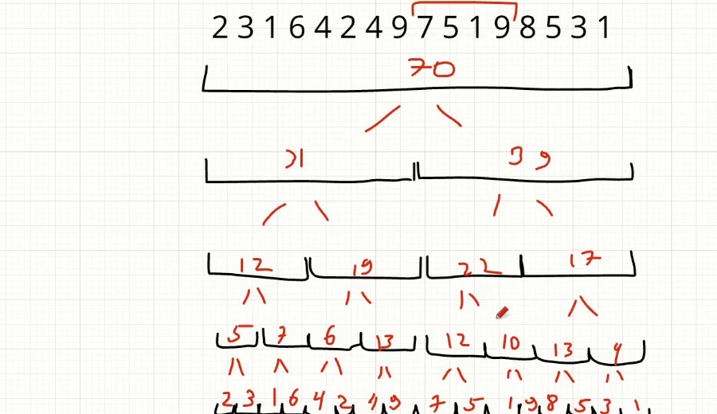
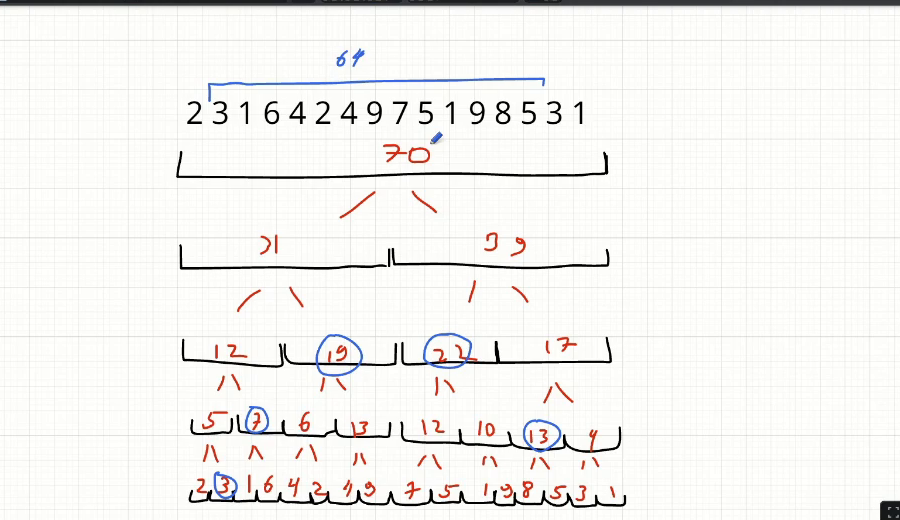
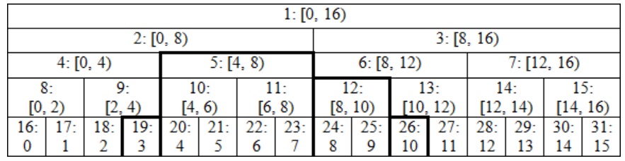

# 19. Дерево отрезков I

> [!NOTE]
> Разбор следует ходу занятия 17.11.2026 и [конспекту по теме 2024 года](https://app.notion.com/p/1362e807d74f80a884f6fc2e9eadaef7). Запись занятия не опубликована по ссылке. Задачи — в [контесте занятия](https://codeforces.com/group/ByhdE7NWBK/contest/733507). Третью задачу на занятии разобрать не успели.

Наша цель — работать с массивом, в котором **запросы суммы чередуются с изменениями элементов**. Разберём не только готовый код, но и смысл каждого рекурсивного вызова. В [примерах](examples/) лежат полные программы C++17 для первых двух задач.

Код ниже следует способу решения с записи. Это учебная редакция, а не дословная запись экрана: комментарии и названия некоторых переменных уточнены, а размер вектора взят с запасом. В [конспекте 2024 года](https://app.notion.com/p/1362e807d74f80a884f6fc2e9eadaef7) границы вершины хранились в отдельных векторах; на занятии 2026 года их передавали параметрами рекурсивных функций. Здесь показан вариант текущего занятия.

## Почему нужна новая идея

Если массив не меняется, сумму на отрезке можно найти с помощью [префиксных сумм](../07-linear-algorithms/README.md): `pref[r] - pref[l]` для полуинтервала `[l, r)`. Но после изменения `a[i]` придётся исправить все префиксы справа от `i` — в худшем случае почти весь массив.

Можно хранить только исходный массив: тогда изменить `a[i]` легко, зато на каждый запрос суммы придётся заново обходить все элементы от `l` до `r`. Нам нужно, чтобы **обе операции** оставались быстрыми, даже если запросы идут вперемешку.

## Сначала представим дерево без кода

Возьмём массив из 16 чисел с доски занятия:

```text
индекс:  0  1  2  3  4  5  6  7 | 8  9 10 11 12 13 14 15
число:   2  3  1  6  4  2  4  9 | 7  5  1  9  8  5  3  1
сумма:            31             |             39
```

Весь массив — один большой отрезок с суммой `70`. Разделим его на левую и правую половины: их суммы `31` и `39`. Каждую половину снова разделим пополам. Будем продолжать, пока в отрезке не останется одно число.



*Кадр с доски занятия: сумма большого отрезка получается из сумм двух половин, и так до отдельных чисел.*

Запись `[l, r)` означает: индекс `l` входит, индекс `r` уже не входит. Поэтому `[4,8)` — элементы `4, 5, 6, 7`. Середина `m = (l + r) / 2` делит `[l,r)` на соседние части `[l,m)` и `[m,r)`. Такое деление работает и тогда, когда длина массива не является степенью двойки.

Каждый отрезок на схеме называют **вершиной дерева**. Самый большой — **корень**, отрезки длины один — **листья**. В листе хранится его единственное число. В остальных вершинах хранится сумма двух детей: например, `[0,16)` получает `31 + 39 = 70`. Нам больше не нужно каждый раз проходить все 16 чисел, чтобы узнать сумму всего массива.

### Как получить сумму произвольного отрезка

Запрошенный отрезок может отсутствовать среди нарисованных. Например, сумма `[1,14)` не записана в одной вершине. Но его можно собрать из готовых частей:

```text
[1,2)  [2,4)  [4,8)  [8,12)  [12,14)
   3      7      19      22       13     = 64
```



*На занятии синим отмечены границы запроса, а кружками — готовые суммы его частей: вместе они дают 64.*

Мы берём **крупные целые части**, которые уже лежат в дереве. Если взять каждый элемент отдельно, экономии не будет. На каждом уровне для такого разбиения нужны не более двух частей возле границ запроса; уровней около `log₂(n)`. Поэтому запрос можно обработать за `O(log n)`.

### Что случится после изменения числа

Если заменить элемент `a[9]` с `5` на `10`, изменится значение листа `[9,10)` и суммы тех вершин, которые содержат этот лист: `[8,10)`, `[8,12)`, `[8,16)` и `[0,16)`. Корень станет `75`. Левую половину массива пересчитывать не нужно: число с индексом `9` в неё не входит. Мы затронули только один путь от листа к корню длиной `O(log n)`.

![После замены a[9] пересчитывается один путь от листа к корню](images/point-update.svg)

*Оранжевые вершины нужно пересчитать; серые отрезки сохраняют прежнюю сумму.*

## Как дерево лежит в `vector`

Отдельные объекты и указатели для вершин не нужны. Заведём вектор `tree`, где `tree[v]` — сумма в вершине с номером `v`. Пронумеруем корень числом `1`. Дети вершины `v` получают номера `2*v` и `2*v+1`. Например, у корня дети `2` и `3`, у вершины `2` — `4` и `5`.



*Схема из [конспекта 2024 года](https://app.notion.com/p/1362e807d74f80a884f6fc2e9eadaef7): над каждой ячейкой указаны номер вершины и её полуинтервал.*

```cpp
vector<long long> tree;  // суммы вершин

// В main после чтения n:
vector<int> a(n, 0);     // исходный массив; в задаче 1 он нулевой
tree.resize(4 * n + 4);
```

В дереве над `n` элементами меньше `2n` настоящих вершин. Например, для 16 чисел это 16 листьев, затем 8, 4, 2 и 1 вершина над ними: всего 31. Размер вектора берём с запасом `4*n+4`, поскольку при нумерации `2*v`, `2*v+1` некоторые ячейки могут остаться пустыми, особенно если `n` не степень двойки. `long long` нужен для сумм: они могут не поместиться в `int`, даже когда отдельные числа помещаются.

Границы отрезка **не обязаны храниться** в вершине. В каждый рекурсивный вызов передадим три числа: номер вершины `v` и границы её отрезка `l`, `r`. Начинаем всегда с `v=1`, `l=0`, `r=n`. Исходный вектор `a` нужен при построении; позднее запросы читают суммы из `tree`.

## `build`: заполнить дерево снизу вверх

Построение отвечает на вопрос: *какая сумма должна лежать в каждой вершине?* Если текущий отрезок состоит из одного элемента, ответ уже известен — `a[l]`. Иначе сначала строим две половины, затем складываем их суммы.

```cpp
void build(int v, int l, int r, vector<int>& a) {
    if (r - l == 1) {          // лист: в [l,r) одно число
        tree[v] = a[l];
        return;
    }

    int m = (l + r) / 2;
    build(2 * v, l, m, a);     // заполняем левую половину
    build(2 * v + 1, m, r, a); // заполняем правую половину
    tree[v] = tree[2 * v] + tree[2 * v + 1];
}

// После создания tree:
build(1, 0, n, a);
```

Почему последнее присваивание стоит **после** рекурсивных вызовов? Пока дети не построены, их суммы неизвестны. На массиве `[2,3,1,6]` функция сначала дойдёт до листьев, затем получит суммы `[0,2) = 5` и `[2,4) = 7`, а в конце запишет в корень `12`.

Каждая вершина посещается один раз, работа внутри неё постоянная. Поэтому построение занимает `O(n)` времени и `O(n)` памяти.

## `get`: спросить вершину о её вкладе

Функция `get(v, l, r, ql, qr)` означает: **какую сумму даёт отрезок вершины `[l,r)` внутри запрошенного отрезка `[ql,qr)`?** Сначала спрашиваем корень. Если он не может ответить сразу, он задаёт тот же вопрос своим детям.

Есть три случая. Их удобно увидеть на отрезках, а затем перевести в условия:

| Положение `[l,r)` относительно `[ql,qr)` | Что вернуть |
| --- | --- |
| Не пересекаются | `0`: общих элементов нет |
| `[l,r)` целиком лежит в запросе | `tree[v]`: сумма уже сохранена |
| Пересекаются лишь частично | Спросить обоих детей и сложить ответы |

Например, при запросе `[1,14)` вершина `[4,8)` целиком входит в запрос и сразу возвращает `19`. Вершина `[14,16)` с ним не пересекается и возвращает `0`. Корень `[0,16)` пересекается лишь частично: сам он вернуть `70` не может, поэтому обращается к детям.

Проследим рекурсию на меньшем массиве `[2,3,1,6]` и запросе `[1,3)`. Корень `[0,4)` пересекается с запросом частично. Его левый ребёнок `[0,2)` получит `0` от `[0,1)` и `3` от `[1,2)`. Правый ребёнок `[2,4)` получит `1` от `[2,3)` и `0` от `[3,4)`. Ответ корня: `(0+3)+(1+0)=4`. При каждом возвращении из функции складываются ответы двух детей.

```cpp
long long get(int v, int l, int r, int ql, int qr) {
    if (ql <= l && r <= qr) return tree[v];      // весь отрезок подходит
    if (r <= ql || qr <= l) return 0;           // общих чисел нет

    int m = (l + r) / 2;
    return get(2 * v, l, m, ql, qr)
         + get(2 * v + 1, m, r, ql, qr);
}

// Сумма на [1,14) для массива длины 16:
long long answer = get(1, 0, 16, 1, 14); // 64
```

Первые две проверки позволяют закончить вызов без спуска к детям: целая вершина отдаёт сохранённую сумму, вершина вне запроса — ноль. Если ни одна проверка не подошла, вызываем обоих детей с **теми же границами запроса** `ql`, `qr`; каждый сам определит свой вклад. Так рекурсия собирает ответ из частей дерева.

Почему запрос не превращается в обход всех листьев? Внутри запрошенного отрезка функция останавливается на вершине, которую можно взять целиком. Снаружи — сразу возвращает ноль. Продолжают спускаться только вершины возле двух границ запроса; глубина дерева `O(log n)`.

## `update`: заменить одно число

Функция `update(v, l, r, index, value)` заменяет число с индексом `index` **в дереве**. В листе записываем новое значение. Внутри дерева идём только в ту половину, где находится `index`; вернувшись, обновляем сумму родителя. Исходный вектор `a` при этом остаётся прежним: после построения он больше не используется для ответов.

```cpp
void update(int v, int l, int r, int index, int value) {
    if (r - l == 1) {
        tree[v] = value;
        return;
    }

    int m = (l + r) / 2;
    if (index < m) update(2 * v, l, m, index, value);
    else update(2 * v + 1, m, r, index, value);

    tree[v] = tree[2 * v] + tree[2 * v + 1];
}

// Присвоить элементу с индексом 9 значение 10:
update(1, 0, 16, 9, 10);
```

Обратите внимание на последнее присваивание: пока изменённый ребёнок не вернулся из рекурсии, новая сумма родителя ещё неизвестна. На каждом уровне выбирается **один** ребёнок, поэтому обновление работает за `O(log n)`.

### Как это превращается в решение задачи 1

В [задаче 1 «Сумма на отрезке»](https://codeforces.com/group/ByhdE7NWBK/contest/733507/problem/1) массив вначале заполнен нулями. Команда `A i x` заменяет элемент с номером `i`, команда `Q L R` спрашивает сумму от `L` до `R` включительно. Номера в условии начинаются с **единицы**, а в дереве мы используем индексы с нуля и `[l,r)`:

```cpp
// A i x:
update(1, 0, n, i - 1, x);

// Q L R:
cout << get(1, 0, n, L - 1, R) << '\n';
```

Правая граница `R` остаётся без изменения: например, позиции `2, 3, 4` из условия переходят в индексы `1, 2, 3`, то есть полуинтервал `[1,4)`. Полная программа и пример ввода находятся в [`examples/segment_tree_sum.cpp`](examples/segment_tree_sum.cpp) и [инструкции к примерам](examples/README.md).

## Задача 2: индекс максимального элемента

На занятии после суммы разобрали [задачу 2 «Индекс максимума на отрезке»](https://codeforces.com/group/ByhdE7NWBK/contest/733507/problem/2). Здесь элементы не меняются, зато ответом должен быть **номер** максимального элемента. Если хранить в вершине только максимальное число, мы не узнаем, где оно стояло. Поэтому на занятии использовали **два вектора**: `tree_max[v]` для максимального значения и `tree_index[v]` для его индекса. В листе это `a[l]` и `l`. Внутри дерева сравниваем максимумы детей и копируем значение вместе с индексом из победившего ребёнка.

Например, в массиве `[2,7,3,7,1]` на всём отрезке максимум равен `7` и встречается дважды. Как в коде занятия, при равных значениях будем выбирать правого ребёнка. В корне сохраним пару «`7`, индекс `3`» (индексы здесь от нуля), а в ответе для задачи выведем номер `4`.

```cpp
if (tree_max[2 * v] > tree_max[2 * v + 1]) {
    tree_max[v] = tree_max[2 * v];
    tree_index[v] = tree_index[2 * v];
} else {
    tree_max[v] = tree_max[2 * v + 1];
    tree_index[v] = tree_index[2 * v + 1];
}
```

Запрос устроен так же, как `get` для суммы, но возвращает `pair<int,int>` — пару из максимума и его индекса. К значению обращаются через `.first`, к индексу — через `.second`. Если вершина не пересекается с запросом, для положительных чисел из этой задачи можно вернуть `{0, -1}`: такая пара не победит настоящее число. При частичном пересечении получаем две пары от детей и выбираем пару с большим первым компонентом. При равенстве условие разрешает любой индекс максимума; на записи выбирали правого ребёнка.

Входные границы этой задачи тоже начинаются с единицы и включают правый конец: `get(1, 0, n, L-1, R)`. Полученный индекс с нуля увеличиваем на единицу при выводе. [Полный пример `max_index.cpp`](examples/max_index.cpp) повторяет этот подход на двух векторах и `pair`, как на занятии.

## Если код пока не складывается

Начните с массива `[2,3,1,6]`. На бумаге подпишите у каждого вызова `build` его `(v,l,r)`, затем проверьте, в каком порядке появляются суммы `5`, `7`, `12`. После этого пройдите `get(1,0,4,1,3)`: ответ должен быть `3+1=4`. Наконец, выполните `update(1,0,4,2,10)` и проверьте, какие суммы изменятся на пути к корню.

Ключевой вопрос для любой рекурсивной функции: **что означает один её вызов?** Для `build` — заполнить всю часть дерева под вершиной; для `get` — найти вклад вершины в запрос; для `update` — исправить вершину после изменения одного элемента. Когда смысл вызова ясен, строки с рекурсией уже следуют из разбиения отрезка пополам.

## Главное

- Лист хранит одно число; сумма внутренней вершины получается из сумм двух детей.
- `get` либо сразу возвращает `0`, либо готовую сумму, либо собирает ответ от детей.
- `update` меняет один лист и его предков; другие ветви остаются прежними.
- `build` работает за `O(n)`, а запрос и точечное изменение — за `O(log n)`.
