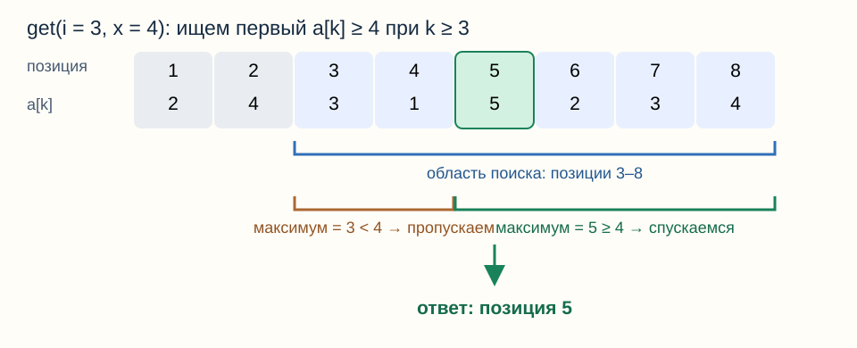
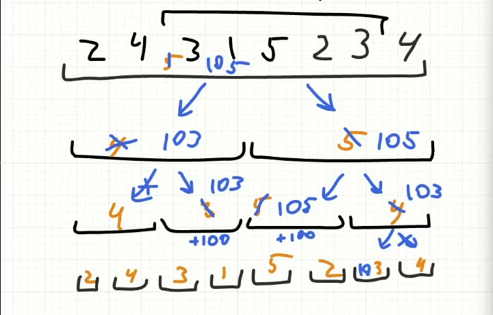
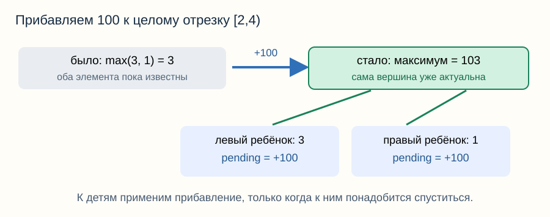

# 20. Дерево отрезков II

> [!NOTE]
> Этот разбор следует записи занятия 21.11.2026 и объяснению из [конспекта 2024 года «Segment Tree 2»](https://app.notion.com/p/1362e807d74f801ea13fe9b16c2426c6). Условия задач находятся в [контесте занятия](https://codeforces.com/group/ByhdE7NWBK/contest/734352). Запись занятия пока не опубликована по ссылке. В конспекте разобраны только те задачи и приёмы, до которых дошли на занятии: задачи 1–3. Остальные задачи контеста — практика.

В [прошлом занятии](https://github.com/MrAnt1vit/coala-2026/tree/main/19-segment-tree-1) дерево хранило сумму или максимум на отрезке. Мы умели быстро **спросить ответ на отрезке** и **заменить один элемент**. Теперь появятся два новых вопроса:

1. Как найти *первую позицию*, удовлетворяющую условию, если дерево хранит только максимум?
2. Как изменить *все элементы отрезка* без обхода каждого листа?

Разберём их по порядку. Первые две программы используют знакомые функции и векторы. `struct` вводится только в третьей задаче, как на записи. Все [полные программы C++17](examples/) — проверенные учебные редакции кода занятия, не дословные снимки экрана.

## Вспоминаем устройство дерева

Вершина `v` отвечает за полуинтервал `[l,r)`: число с индексом `l` входит, с индексом `r` уже не входит. Её дети отвечают за `[l,mid)` и `[mid,r)`, где `mid=(l+r)/2`; их номера в векторе — `2*v` и `2*v+1`. В листе `r-l=1`, и хранится ответ для одного числа. Внутреннюю вершину строим из двух детей.

Например, дерево для минимума хранит в `tree[v]` минимум своего отрезка. После замены одного числа `update` меняет его лист, а затем пересчитывает вершины на пути к корню. `get` для запроса использует три случая: нет пересечения — возвращает нейтральный ответ; вершина целиком внутри запроса — отдаёт готовое значение; частичное пересечение — спрашивает детей. На занятии эта схема была ещё раз записана для задачи о минимуме и использована для поиска ошибки в решении ученика. Ошибка была в выборе ребёнка при построении: отладчик помог увидеть, что для отрезка `[4,5)` сохранилось чужое число. Это полезная проверка: если ответ неверен уже **до обновлений**, сначала осмотрите `build` и границы рекурсии.

## Задача 1. Ближайшее большее число справа

[Условие](https://codeforces.com/group/ByhdE7NWBK/contest/734352/problem/1) даёт два вида запросов: `set(i,x)` заменяет `a[i]` на `x`; `get(i,x)` ищет минимальный индекс `k ≥ i`, для которого `a[k] ≥ x`. Позиции во входе нумеруются с единицы. Если подходящего числа нет, ответ `-1`.

### Как узнать, есть ли ответ внутри вершины

Допустим, перед нами отрезок массива и порог `x`. Если хранить **максимум** каждого отрезка, можно быстро понять, есть ли в нём хотя бы одно число `≥ x`:

- `tree[v] < x` — ни одно число в вершине не подходит, её можно пропустить;
- `tree[v] ≥ x` — подходящее число существует, но мы пока не знаем его позицию.

Для второй ситуации пойдём сначала в левого ребёнка. Если его максимум достаточен, ответ находится там. Иначе берём правого. Так мы доберёмся до самого левого подходящего листа. Важно: **максимум нужен для выбора пути, а ответом будет индекс листа**, а не сам максимум.



*Самостоятельная схема по разбору задачи 1 на занятии. В массиве `[2,4,3,1,5,2,3,4]` при `get(3,4)` первая подходящая позиция — 5. Число 4 на позиции 2 не участвует: оно левее начала поиска.*

### Зачем нужны две части поиска

Сначала обычная функция `get` ограничивает область `[i,n)`. В каждой вершине она различает знакомые случаи:

1. Вершина вне `[i,n)` — ответ `-1`.
2. Вершина целиком внутри `[i,n)` — если её максимум меньше `x`, ответ `-1`; иначе вызываем `find_first`.
3. Вершина пересекается с `[i,n)` частично — сначала спрашиваем левого ребёнка. Только если он вернул `-1`, спрашиваем правого.

Здесь нельзя просто выбрать левого ребёнка по его максимуму **до проверки границ**: его большой элемент может оказаться левее `i`. Функция `find_first`, напротив, вызывается лишь тогда, когда вся рассматриваемая вершина находится в запросе и ответ в ней точно есть. Поэтому ей достаточно на каждом шаге сравнивать максимум левого ребёнка с `x`.

Проследим рисунок. Запрос `get(3,4)` означает позиции 3–8. Подотрезок позиций 3–4 имеет максимум `3`, поэтому отбрасывается. Правая половина имеет максимум `5`: в ней ответ есть. При спуске сначала попадаем на позицию 5 со значением `5` и возвращаем её номер. Если после `set(5,1)` повторить запрос, поиск пройдёт дальше и найдёт позицию 8 со значением `4`.

В [программе задачи 1](examples/first_ge.cpp) `build` и точечный `update` отличаются от прошлого занятия лишь тем, что объединяют детей через `max`. `get` возвращает индекс в нулевой индексации, а `main` переводит его обратно в нумерацию условия. Построение — `O(n)`, каждый запрос и замена — `O(log n)`.

## Почему точечного изменения теперь мало

Во [второй задаче](https://codeforces.com/group/ByhdE7NWBK/contest/734352/problem/2) нужно прибавлять одно число ко **всем** элементам выбранного отрезка и узнавать максимум. Если для обновления `[l,r]` вызывать старый точечный `update` для каждого элемента, запрос на почти весь массив займёт `O(n log n)`. Нам нужно сохранить время порядка `O(log n)`.

Ключевое наблюдение: если ко всем числам отрезка прибавить `100`, его максимум тоже просто увеличится на `100`. Чтобы обновить максимум **целой вершины**, знать отдельные новые значения её листьев пока не требуется. Достаточно изменить ответ вершины и запомнить, что её детям это прибавление ещё предстоит получить. Такое отложенное действие называют **ленивым обновлением**; на занятии оно называется `push`.

### Один запрос на доске

На доске разбирается массив `[2,4,3,1,5,2,3,4]`. Прибавим `100` к позициям 3–7, то есть к полуинтервалу `[2,7)` в нулевой индексации. В дереве это покрытие можно остановить на целых вершинах `[2,4)` и `[4,6)`, а также на листе `[6,7)`. Их максимумы станут `103`, `105` и `103`. Остальные числа не изменятся; максимум всего массива станет `105`.



*Фрагмент доски записи около 55-й минуты. Синим показаны новые максимумы и отметки `+100`, которые пока не спустились до листьев; промежуточные исправления преподавателя оставлены в кадре.*

Представьте, что вершина `[2,4)` до обновления хранит максимум `3`, а её листья хранят `3` и `1`. Сразу после полного обновления вершина уже сообщает максимум `103`. Листья пока могут хранить прежние `3` и `1`, но возле них записано отложенное `+100`. Когда понадобится обратиться к одному из листьев, мы применим отложенное прибавление и получим `103` или `101`.



*Схема механизма `push_node` по примеру занятия: число в родителе актуально, изменения детей откладываются до обращения к ним.*

### Что именно хранится в `push`

В реализации занятия есть два вектора: `tree[v]` — максимум вершины, `pending[v]` (на экране `push[v]`) — прибавление, **ещё не применённое к самой этой вершине**. Нейтральное значение `pending[v]` — ноль. Если к вершине пришли два прибавления, например `30` и `20`, они складываются: до применения нужно добавить `50`.

Функция `push_node(v,l,r)` выполняет три шага:

```cpp
tree[v] += pending[v];
if (r - l != 1) {           // у листа нет детей
    pending[2 * v] += pending[v];
    pending[2 * v + 1] += pending[v];
}
pending[v] = 0;
```

После вызова `tree[v]` уже верен. У детей пока могут быть старые максимумы; прибавления записаны в их `pending`. При новом спуске дети выполнят тот же `push_node`. Поэтому старые значения листьев не означают ошибку: дерево отвечает правильно, если перед использованием вершины применяет её отложенное действие.

### Как меняются `update` и `get`

`build` по-прежнему кладёт в каждый лист исходное число и берёт максимум детей. Отложенные прибавления изначально равны нулю.

В начале `update(v,l,r,ql,qr,value)` вызываем `push_node(v,l,r)`. Затем:

1. Нет пересечения с `[ql,qr)` — выходим.
2. Вершина целиком внутри `[ql,qr)` — прибавляем `value` к её `pending`, тут же выполняем `push_node` и выходим. Её максимум стал актуальным, но ниже спускаться пока не пришлось.
3. Частичное пересечение — обновляем обоих детей, затем ставим в родителя максимум из их **актуальных** ответов.

Повторный `push_node` в случае 2 важен: вызвавший нас родитель сейчас пересчитает свой максимум по детям. Если оставить значение вершины старым, пересчёт будет неверным.

`get` начинает с `push_node` по той же причине. Далее работают прежние случаи: вне запроса вернуть `-1` (элементы этой задачи неотрицательны), целиком внутри — `tree[v]`, при частичном пересечении — максимум ответов детей. Полная [программа задачи 2](examples/range_add_max.cpp) повторяет этот порядок. Сумма возможных прибавлений может превысить `int`, поэтому максимум и отложенное прибавление хранятся в `long long`. Построение занимает `O(n)`, каждая операция — `O(log n)`.

## Задача 3. Присваивание на отрезке

[Третья задача](https://codeforces.com/group/ByhdE7NWBK/contest/734352/problem/3) меняет все числа выбранного отрезка **на одно и то же значение** и спрашивает **сумму** на отрезке. Исходный массив заполнен нулями. Общая идея отложенного действия остаётся, но у нового действия другие правила.

Если вершина длины `r-l` целиком получила присваивание `x`, её сумма сразу известна: `(r-l)*x`. Старые значения детей можно пока не менять. Однако новое присваивание **заменяет** старое. Если сначала запланировали `2`, а потом `5`, результатом должно быть `5`, а не `7`. Поэтому в `push_node` детей получают `push = x`, а не `push += x`.

Для прибавления нейтральным отложенным действием был `0`. Для присваивания любое обычное число меняет массив, даже ноль. В условии `x ≥ 0`, поэтому значение `-1` удобно выбрать как отметку «нет отложенного присваивания».

### Здесь впервые появляется `struct`

На этой части занятия преподаватель показывает, как не вести отдельные векторы для каждой характеристики вершины. `struct Node` — собственный тип, у которого несколько именованных полей. У вершины есть сумма `sum`, отложенное присваивание `push` и границы `l`, `r`. Запись `tree[v].sum` означает «поле `sum` вершины `v`». Поиск детей по номерам `2*v`, `2*v+1` и сама рекурсия остаются прежними.

```cpp
struct Node {
    long long sum = 0;
    long long push = -1;
    int l = 0, r = 0;
};
vector<Node> tree;
```

Границы теперь сохранены внутри вершины, поэтому `update`, `get` и `push_node` получают только номер `v` и параметры запроса. `build(v,l,r)` заполняет эти границы при создании дерева.

На примере из условия: после `A 2 3 2` массив длины пять — `[0,2,2,0,0]`; после `A 3 5 1` он станет `[0,2,1,1,1]`; после `A 4 5 2` — `[0,2,1,2,2]`. Поэтому `Q 1 3` даёт `3`, а `Q 1 5` даёт `7`. Запросы и присваивания чередуются, но все значения листьев не обязаны пересчитываться при каждом `A`.

В [программе задачи 3](examples/range_assign_sum.cpp) `push_node` сначала проверяет, есть ли отложенное присваивание. Если есть, она заменяет сумму на `(r-l)*push`, передаёт **то же присваивание** детям, если они существуют, и возвращает `push=-1`. `update` и `get` следуют уже знакомым трём случаям для отрезков; родитель складывает суммы детей. `long long` нужен и для `sum`, и для произведения длины на `x`. Время построения — `O(n)`, каждого запроса — `O(log n)`.

## Что важно запомнить

- Максимум на вершине помогает найти **первую позицию** с числом не меньше порога: сначала отсечь неподходящие отрезки, затем идти в самого левого подходящего ребёнка.
- При полном обновлении отрезка можно сразу обновить ответ вершины и отложить работу с её детьми. Перед использованием вершины отложенное действие надо применить через `push_node`.
- Прибавления складываются (`+=`), а присваивание заменяет более старое присваивание (`=`). От этого зависит корректность нескольких обновлений подряд.
- В третьей задаче `struct` лишь собирает поля одной вершины вместе. Принцип разбиения массива и три случая запроса остаются теми же.

Термины занятия собраны в [локальном глоссарии](glossary.md). Для запуска и проверки примеров откройте [страницу программ](examples/README.md).
