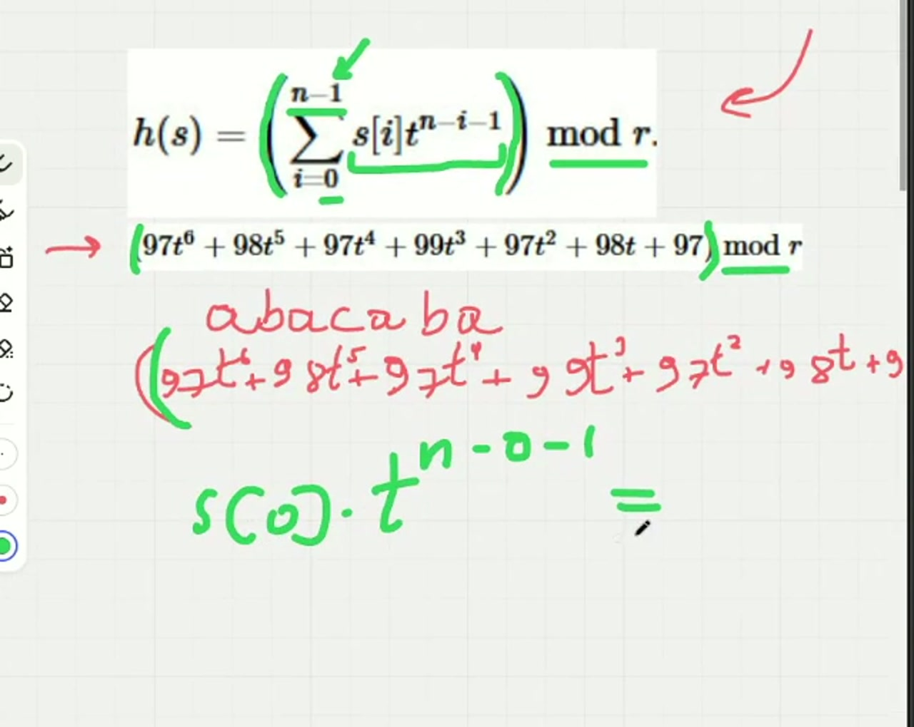
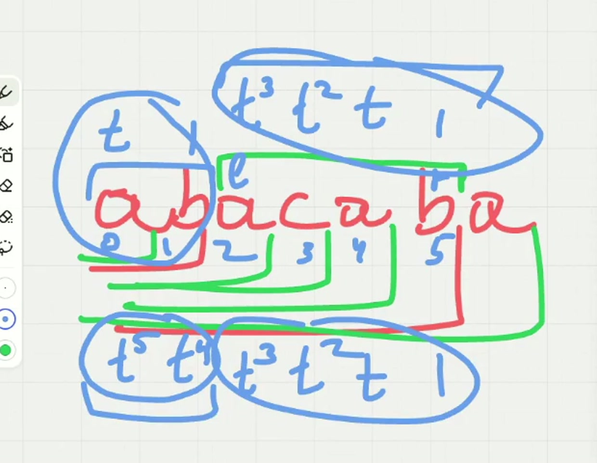
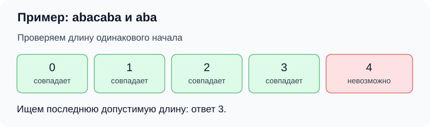

# 21. Строки и хеширование

На занятии 24 ноября 2026 года мы разбирали задачи [контеста «21. Строки и хеширование»](https://codeforces.com/group/ByhdE7NWBK/contest/735205). Сначала научились вычислять число для целой строки, затем получать хеш любого её фрагмента за постоянное время. После этого применили готовую операцию к сравнению строк, поиску образца и поиску их общего начала. Здесь показаны именно первые пять задач, которые были разобраны на записи; остальные задачи контеста оставлены для самостоятельной практики.

Материал опирается на [запись занятия](#источники) и [конспект курса 2024 года](https://app.notion.com/p/1362e807d74f806da348f843c3d8d39d). Коды ниже — запускаемые учебные редакции решений с занятия, а не дословная расшифровка экрана. Порядок идей и способы решения сохранены. Условные обозначения и [краткие определения](glossary.md) можно посмотреть отдельно.

## Зачем строке сопоставлять число

Если при каждом запросе сравнивать две подстроки посимвольно, в худшем случае придётся прочитать всю их длину. Когда строка длинная, а запросов много, это дорого. **Хеш** — число, вычисленное из символов строки по фиксированному правилу. Одинаковые строки получают одинаковый хеш. По одному лишь совпадению хешей строго доказать равенство строк нельзя: разных строк больше, чем возможных остатков, и бывают **коллизии**. Для большинства учебных задач правильно подобранные параметры дают практически полезную быструю проверку; в четвёртой задаче увидим, почему одного хеша иногда мало.

В задачах этого занятия используется **полиномиальный хеш**. Каждый символ заменяется его числовым кодом, а последовательность кодов читается как «число по основанию $t$» с взятием остатка по $r$. Например, код латинской `a` равен 97, `b` — 98. Для `aba` выражение выглядит так:

$$h(\texttt{aba})=(97t^2+98t+97)\bmod r.$$

В условии [задачи 1](https://codeforces.com/group/ByhdE7NWBK/contest/735205/problem/1) та же идея записана суммой для произвольной длины. На доске сначала раскрыли её для `abacaba`:



Чем левее символ, тем большая степень $t$ стоит рядом с ним. Остаток по $r$ удерживает значения в ограниченном диапазоне. Параметры $t$ и $r$ в первых двух задачах заданы во входных данных; дальше их выбираем сами.

## Задача 1. Хеши префиксов

**Префикс** — начало строки. [Задача 1](https://codeforces.com/group/ByhdE7NWBK/contest/735205/problem/1) просит вывести хеши первого символа, первых двух символов и так далее. Если заново вычислять сумму для каждого префикса, суммарно получится $1+2+\ldots+n=O(n^2)$ действий. Вместо этого поддерживаем хеш уже прочитанного начала строки.

Пусть $H_i$ — хеш первых $i$ символов, $H_0=0$. При добавлении символа `s[i]` старые степени все увеличиваются на единицу, а новый код получает степень ноль:

$$H_{i+1}=(H_i\cdot t+\operatorname{code}(s[i]))\bmod r.$$

Для `aba` это видно по шагам: $H_1=97$, $H_2=97t+98$, $H_3=(97t+98)t+97$. Остаток можно брать на каждом шаге: это не меняет итоговый остаток и не позволяет промежуточной сумме вырасти до огромного числа. Произведение двух чисел до $10^9$ и код символа укладываются в `long long` при ограничениях задачи. В коде весь алгоритм выглядит так:

```cpp
long long h = 0;
for (char c : s) {
    h = (h * t + static_cast<unsigned char>(c)) % r;
    cout << h << '\n';
}
```

[Полная программа](examples/prefix_hashes.cpp) использует ровно этот цикл. Время $O(n)$, дополнительная память $O(1)$.

## Задача 2. Хеши подстрок

Теперь [запрос](https://codeforces.com/group/ByhdE7NWBK/contest/735205/problem/2) указывает **подстроку** `s[left..right]`: непрерывный фрагмент с обоими концами включительно, индексация с нуля. Пересчитывать её посимвольно при каждом из $10^5$ запросов нельзя. Уже известные хеши префиксов позволяют вычесть из длинного префикса ненужное начало.

Для этого запоминаем массив $H$: $H_i$ — хеш первых $i$ символов. Значит, $H_0=0$, а `H[right+1]` относится ко всем символам до `right` включительно. Также запоминаем степени $P_k=t^k\bmod r$, начиная с $P_0=1$.

На записи для `abacaba` рассматривается фрагмент `s[2..5] = "acab"`. Хеш первых шести символов состоит из хеша `ab`, умноженного на $t^4$, и хеша `acab`. Умножение нужно, чтобы степени символов `ab` стали такими же, как внутри более длинного префикса:

$$H_6 = H_2\cdot t^4 + h(\texttt{acab})\pmod r.$$



В общем случае длина нужного фрагмента равна `len = right-left+1`, поэтому

$$h(s[left..right])=(H_{right+1}-H_{left}\cdot P_{len})\bmod r.$$

В C++ остаток отрицательного числа может быть отрицательным. После вычитания прибавляем $r$ и ещё раз берём `% r`:

```cpp
int len = right - left + 1;
long long answer = (h[right + 1] - h[left] * power[len] % r + r) % r;
```

В [программе задачи 2](examples/substring_hashes.cpp) первые два цикла готовят $H$ и $P$ за $O(n)$, после чего запрос стоит $O(1)$. Важные границы: `H[left]` содержит символы *до* фрагмента; `H[right+1]` содержит фрагмент целиком.

Проверка на примере из условия: при $t=7$, $r=19$ и `s="abacaba"` запрос `[1,3]` берёт `"bac"` и даёт хеш `13`. Запрос `[0,0]` даёт `97 mod 19 = 2`.

## Задача 3. Сравнения подстрок

В [задаче 3](https://codeforces.com/group/ByhdE7NWBK/contest/735205/problem/3) на каждый запрос надо сказать, равны ли `s[a..b]` и `s[c..d]`. Нумерация здесь **с единицы**, оба конца включены. Например, в `trololo` фрагменты `[3..5]` и `[5..7]` оба равны `olo`.

Мы уже умеем получать хеш каждого фрагмента. Преподаватель вынес вычисление префиксов в `precalc`, а получение хеша фрагмента — в `get_hash`; эти функции затем используются и в следующих задачах. Сначала сравниваем длины фрагментов, затем их хеши. Неравные хеши гарантируют, что строки различаются; равные хеши считаем совпадением с оговоркой о коллизиях. Параметры теперь выбираются в программе: в [учебном коде](examples/compare_substrings.cpp) $t=31$, $r=10^9+7$. При желании можно сменить параметры, но это не превращает хеш в точное доказательство равенства.

Функция `get_hash(left,right)` в примерах принимает **полуинтервал** `[left,right)`: `right` не входит. Поэтому границы запроса `a,b` из условия превращаются в `get_hash(a-1,b)`. Это тот же фрагмент: начало переведено с единицы на ноль, правая граница уже указывает на первый символ после него. Предвычисление $O(n)$, один запрос $O(1)$; на занятии дополнительно включили быстрый ввод и вывод из-за $10^5$ запросов и жёсткого ограничения по времени.

## Задача 4. Быстрый поиск подстроки

[Задача 4](https://codeforces.com/group/ByhdE7NWBK/contest/735205/problem/4) даёт образец `p` и текст `s`; требуется найти все позиции, с которых образец входит в текст. Пробуем каждое возможное начало `i`, для которого `i + p.size() <= s.size()`. Хеш образца вычисляем один раз, а хеш каждого фрагмента текста длины `|p|` берём за $O(1)$. Например, `aba` встречается в `abaCaba` с позиций 1 и 5 при нумерации с единицы.

Первая версия на занятии использовала один хеш и получила неверный ответ на тестах: появились ложные вхождения. Это как раз коллизии, о которых говорили в начале. Преподаватель добавил **второй независимый расчёт** с $t_1=31$, $r_1=10^9+7$ и $t_2=29$, $r_2=10^9+9$. Теперь сравниваются пары `(h1,h2)`; кандидат засчитывается, только если совпали обе компоненты. [Программа задачи 4](examples/find_occurrences.cpp) повторяет эту схему. Два хеша сильно снижают риск случайных совпадений, но сами по себе не дают математической гарантии отсутствия коллизий.

Каждую пару префиксов и степеней готовим за $O(|s|)$, образец хешируем за $O(|p|)$, проверяем не больше $|s|$ позиций. Итого $O(|s|+|p|)$ времени и $O(|s|)$ памяти. Когда `|p|>|s|`, цикл не выполняется и ответ равен нулю. Пересекающиеся вхождения тоже учитываются: после проверки `i` мы сдвигаемся на один символ, а не на длину образца.

## Задача 5. Наибольший общий префикс

В [задаче 5](https://codeforces.com/group/ByhdE7NWBK/contest/735205/problem/5) запрос `(x,y)` задаёт два **суффикса** одной строки: `s[x..n-1]` и `s[y..n-1]`. Нужно найти длину их одинакового начала. Для `abacaba` запрос `(0,4)` сравнивает `abacaba` и `aba`; общий префикс — `aba`, ответ `3`. Запрос `(0,2)` сравнивает `abacaba` и `acaba`, ответ `1`.

Если первые $k$ символов двух суффиксов совпали, совпали и первые $1,2,\ldots,k-1$. Если они уже различаются на первых $k$ символах, любой более длинный префикс тоже различается. Такое свойство позволяет применить [бинарный поиск](../08-binary-search/): проверяем середину диапазона возможных длин и сужаем его. Проверка длины `mid` — это сравнение `get_hash(x,x+mid)` и `get_hash(y,y+mid)` за $O(1)$.



В [программе задачи 5](examples/longest_common_prefix.cpp) `low=0` всегда обозначает допустимую длину, а `high=min(n-x,n-y)+1` — заведомо недопустимую искусственную границу. Пока между ними больше единицы, проверяем `mid`:

```cpp
int low = 0, high = min(n - x, n - y) + 1;
while (high - low > 1) {
    int mid = (low + high) / 2;
    if (get_hash(x, x + mid) == get_hash(y, y + mid)) low = mid;
    else high = mid;
}
cout << low << '\n';
```

Если хеши равны, сохраняем `low=mid`, иначе `high=mid`. Эта граница `+1` важна: общий префикс может занимать весь более короткий суффикс. Как и на записи, здесь использован один хеш; при необходимости риск коллизий можно уменьшить двойным хешем по образцу задачи 4. Предвычисление $O(n)$, каждый запрос $O(\log n)$.

## Что осталось в контесте

На записи не разбирались задачи [A «Период строки»](https://codeforces.com/group/ByhdE7NWBK/contest/735205/problem/A), [B «Различные подстроки»](https://codeforces.com/group/ByhdE7NWBK/contest/735205/problem/B), [C «Сравнение подстрок 2»](https://codeforces.com/group/ByhdE7NWBK/contest/735205/problem/C), [D «Ошибка передачи сообщения»](https://codeforces.com/group/ByhdE7NWBK/contest/735205/problem/D) и [ZA «Максимальные подпалиндромы»](https://codeforces.com/group/ByhdE7NWBK/contest/735205/problem/ZA). Их можно решать как практику; преподаватель отдельно упомянул задачу о периоде. Для задачи 5 есть [разбор 2024 года](https://app.notion.com/p/1362e807d74f80c483dbd076c6c19d23), но он не заменяет объяснение занятия выше.

## Главное к запоминанию

- Следующий префикс получается из предыдущего по формуле `new = (old*t + code) % r`.
- Хеш фрагмента равен хешу длинного префикса минус хеш ненужного начала, умноженный на нужную степень $t$.
- В коде всегда проверяйте, включена ли правая граница и с нуля или единицы нумеруются символы.
- Совпадение хешей допускает коллизию. На занятии из-за этого пришлось заменить один хеш двумя в задаче 4.
- Для двух суффиксов проверка совпадения первых $k$ символов монотонна по $k$, поэтому длину их общего начала можно найти бинарным поиском.

## Как запустить программы

Каждый файл в [examples](examples/) — самостоятельная программа C++17. Например, из этой папки:

```bash
g++ -std=c++17 -O2 -Wall -Wextra -pedantic examples/substring_hashes.cpp -o substring_hashes
./substring_hashes
```

Вставьте вход из соответствующего условия контеста. Для Windows имя запускаемого файла будет `substring_hashes.exe`.

## Источники

- Запись занятия «21. Строки и хеширование» от 24.11.2026, продолжительность 1:22:32. Иллюстрации с доски выше взяты из неё.
- [Контест Коалиции 2026, занятие 21](https://codeforces.com/group/ByhdE7NWBK/contest/735205).
- [Конспект «XXIV. Strings. Hashes.» курса 2024 года](https://app.notion.com/p/1362e807d74f806da348f843c3d8d39d) и [разбор дополнительных задач](https://app.notion.com/p/1362e807d74f80c483dbd076c6c19d23).
